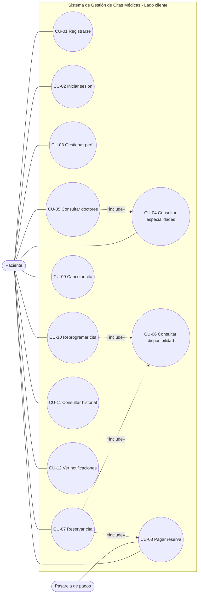
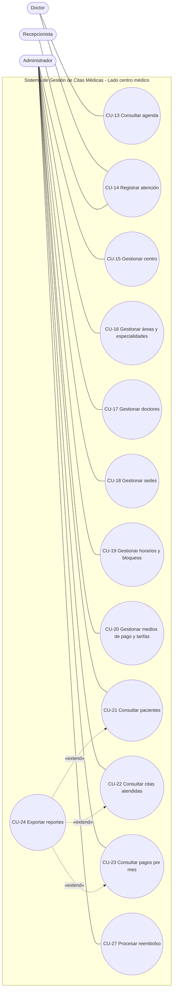
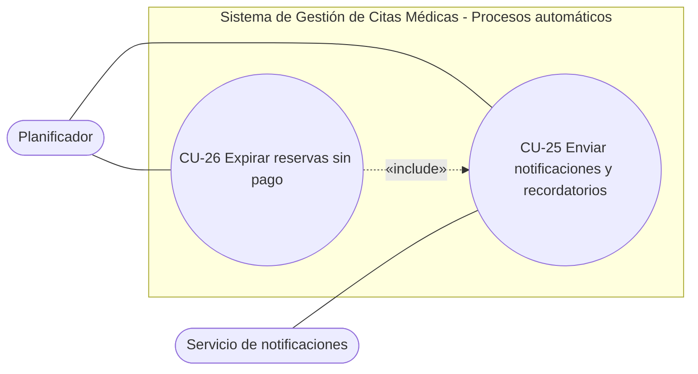
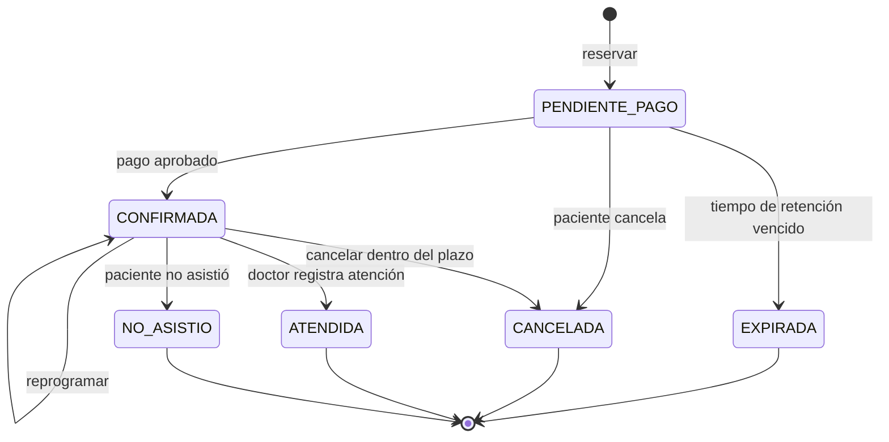
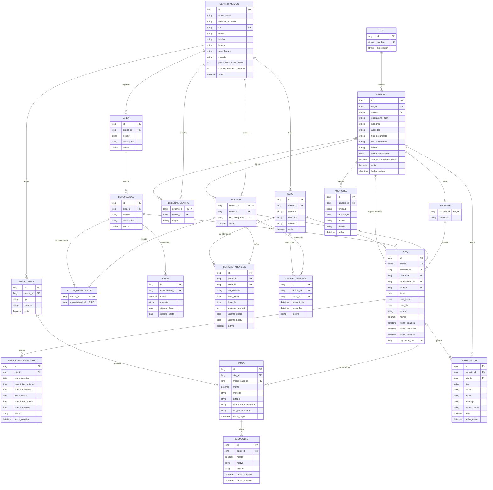
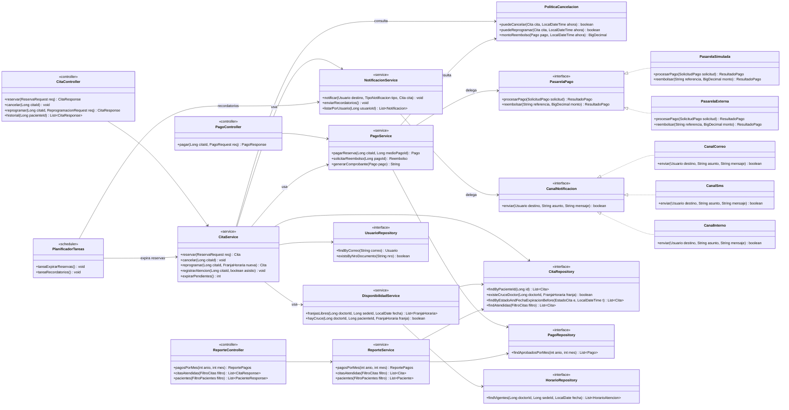

# Sistema de Gestión de Citas Médicas

**Curso:** Programación Orientada a Objetos
**Versión del documento:** 0.3 (borrador)

> **Estructura del archivo:** la **Parte I** (Secciones 1 a 11) es el documento de trabajo con el análisis y el diseño. La **Parte II, Documentación final** (al final del archivo) tiene el índice del entregable y se irá completando.

## Integrantes

| N.º | Nombre completo |
|-----|-----------------|
| 1 | Jorgin Jampier Chicoma Sullon |
| 2 | Esteban Angel Zambrano Canales |
| 3 | Mayte Chinchay Espinoza |
| 4 | Carlos Andrade Chaparro Torres |
| 5 | Gerald David Osores Peña |

---

## 1. Introducción

### 1.1 Problemática

Sacar una cita en una institución médica es un proceso complicado. Habitualmente el paciente debe acudir presencialmente al centro o llamar por teléfono, con tiempos de espera largos y llamadas que se cortan por tiempo excedido. A esto se suman la duplicidad y el cruce de horarios entre citas, y las reprogramaciones lentas.

### 1.2 Solución propuesta

Un sistema de gestión de citas médicas que permita al paciente consultar especialidades y doctores, reservar y pagar su cita en línea, y que dé al centro médico herramientas para administrar su oferta (sedes, horarios, doctores, medios de pago) y consultar su operación.

El sistema debe ser **genérico**: no está customizado a un solo centro médico, sino que puede adaptarse a distintas instituciones mediante configuración de sus propios datos.

### 1.3 Alcance

**Incluye:**
- Gestión de usuarios (pacientes) y su autenticación.
- Catálogo de especialidades, doctores, sedes y horarios.
- Reserva de citas presenciales con control de disponibilidad.
- Pago de la reserva mediante medios de pago configurables.
- Historial de reservas y notificaciones.
- Módulo administrativo del centro médico con consultas y reportes básicos.

**No incluye (por ahora):**
- Teleconsulta o atención virtual (solo citas presenciales).
- Historia clínica electrónica ni registro de diagnósticos.
- Facturación electrónica ante la autoridad tributaria.
- Gestión de farmacia, inventarios o laboratorio.

> Los límites del alcance se validarán y ajustarán en las siguientes sesiones.

### 1.4 Stack tecnológico

| Componente | Tecnología |
|------------|------------|
| Lenguaje | Java 17 |
| Gestión de build | Gradle |
| Framework | Spring Boot 4.1.1 |
| IDE | IntelliJ IDEA |
| Base de datos | PostgreSQL |
| Front-end | HTML5 (con CSS3 y JavaScript), consumiendo la API REST |

---

## 2. Actores

### 2.1 Actores primarios (personas)

| ID | Actor | Descripción | Objetivos principales |
|----|-------|-------------|-----------------------|
| ACT-01 | **Paciente** | Persona registrada que solicita atención médica en un centro. | Registrarse, consultar especialidades y doctores, reservar y pagar citas, revisar su historial, recibir notificaciones. |
| ACT-02 | **Administrador del centro médico** | Responsable de configurar y supervisar el centro en el sistema. | Registrar los datos del centro, áreas, especialidades, doctores, sedes, horarios y medios de pago; consultar pacientes, citas atendidas y pagos mensuales. |
| ACT-03 | **Doctor** | Profesional de salud que atiende las citas. | Consultar su agenda y marcar las citas como atendidas. |
| ACT-04 | **Personal administrativo / Recepcionista** *(opcional)* | Personal de sede que apoya la atención presencial. | Registrar asistencia del paciente, apoyar reservas o reprogramaciones presenciales. |

> **Nota de diseño:** ACT-03 y ACT-04 no aparecen explícitamente en el alcance original. Se proponen porque alguien debe marcar la cita como "atendida" (necesario para la consulta de citas atendidas). Se puede simplificar dejando esta función al Administrador.

### 2.2 Actores secundarios (sistemas externos)

| ID | Actor | Descripción | Interacción con el sistema |
|----|-------|-------------|----------------------------|
| ACT-05 | **Pasarela de pagos** | Servicio externo que procesa pagos (tarjeta, billeteras digitales, etc.). | Procesa el cobro de la reserva y confirma o rechaza la transacción. |
| ACT-06 | **Servicio de notificaciones** | Proveedor de correo electrónico, SMS o mensajería. | Entrega las notificaciones al paciente. |

### 2.3 Actor interno

| ID | Actor | Descripción |
|----|-------|-------------|
| ACT-07 | **Planificador (Scheduler)** | Proceso automático del sistema que dispara tareas por tiempo: recordatorios de cita, expiración de reservas sin pago, cierre de citas vencidas. |

### 2.4 Resumen de actores por lado del sistema

| Lado del sistema | Actores |
|------------------|---------|
| Cliente | Paciente |
| Centro médico | Administrador, Doctor, Personal administrativo |
| Externos / automáticos | Pasarela de pagos, Servicio de notificaciones, Planificador |

---

## 3. Requerimientos funcionales

**Prioridad:** Alta = indispensable para la primera versión. Media = deseable. Baja = mejora futura.
**Origen:** *Base* = indicado en el contexto original. *Propuesto* = añadido por el equipo para cubrir la problemática o por necesidad técnica.

### 3.1 Módulo de Seguridad y Usuarios

| ID | Requerimiento | Actor | Prioridad | Origen |
|----|---------------|-------|-----------|--------|
| RF-01 | El sistema debe permitir el **registro de un usuario paciente** con datos personales (nombres, documento de identidad, fecha de nacimiento, correo, teléfono) y contraseña. | Paciente | Alta | Base |
| RF-02 | El sistema debe permitir **iniciar y cerrar sesión** a todos los tipos de usuario. | Todos | Alta | Propuesto |
| RF-03 | El sistema debe restringir las funciones según el **rol** del usuario (paciente, administrador, doctor, personal administrativo). | Todos | Alta | Propuesto |
| RF-04 | El sistema debe permitir al usuario **actualizar su perfil** y **recuperar su contraseña**. | Paciente | Media | Propuesto |
| RF-05 | El sistema debe evitar el registro duplicado de pacientes con el mismo documento de identidad. | Paciente | Alta | Propuesto |

### 3.2 Módulo de Configuración del Centro Médico

| ID | Requerimiento | Actor | Prioridad | Origen |
|----|---------------|-------|-----------|--------|
| RF-06 | El sistema debe permitir **registrar y editar los datos del centro médico** (razón social, nombre comercial, identificación fiscal, contacto, logo). | Administrador | Alta | Base |
| RF-07 | El sistema debe permitir **registrar y gestionar áreas y especialidades** médicas del centro. | Administrador | Alta | Base |
| RF-08 | El sistema debe permitir **registrar y gestionar doctores** (datos personales, colegiatura, especialidades que atiende). | Administrador | Alta | Base |
| RF-09 | El sistema debe permitir **registrar y gestionar sedes** del centro (nombre, dirección, contacto). | Administrador | Alta | Base |
| RF-10 | El sistema debe permitir **definir los horarios de atención** de cada doctor por sede (días, rango de horas, duración de la cita). | Administrador | Alta | Base |
| RF-11 | El sistema debe permitir **registrar y gestionar los medios de pago** aceptados por el centro y su costo por especialidad o por cita. | Administrador | Alta | Base |
| RF-12 | El sistema debe permitir **bloquear horarios** (vacaciones, licencias, feriados) de un doctor o sede. | Administrador | Media | Propuesto |
| RF-13 | El sistema debe permitir **activar o desactivar** doctores, sedes, especialidades y medios de pago sin eliminar su historial. | Administrador | Media | Propuesto |

### 3.3 Módulo de Consulta y Reserva de Citas (lado del cliente)

| ID | Requerimiento | Actor | Prioridad | Origen |
|----|---------------|-------|-----------|--------|
| RF-14 | El sistema debe permitir **consultar las especialidades** disponibles del centro. | Paciente | Alta | Base |
| RF-15 | El sistema debe permitir **consultar los doctores** de una especialidad seleccionada, con su sede. | Paciente | Alta | Base |
| RF-16 | El sistema debe mostrar la **disponibilidad de horarios** (fecha y hora) de un doctor en una sede. | Paciente | Alta | Propuesto |
| RF-17 | El sistema debe permitir **reservar una cita presencial** seleccionando especialidad, doctor, sede, fecha y hora. | Paciente | Alta | Base |
| RF-18 | El sistema debe **impedir la duplicidad y el cruce de citas**: un doctor no puede tener dos citas en el mismo horario y un paciente no puede tener dos citas simultáneas. | Sistema | Alta | Propuesto (problemática) |
| RF-19 | El sistema debe mantener un **estado de la cita** a lo largo de su ciclo de vida: *Pendiente de pago, Confirmada, Atendida, Cancelada, No asistió, Expirada*. | Sistema | Alta | Propuesto |
| RF-20 | El sistema debe **retener temporalmente el horario** seleccionado durante el pago y **liberarlo automáticamente** si el pago no se completa en el tiempo definido. | Sistema / Planificador | Alta | Propuesto |
| RF-21 | El sistema debe permitir **cancelar una cita** respetando la política del centro (plazo mínimo). | Paciente | Media | Propuesto (problemática) |
| RF-22 | El sistema debe permitir **reprogramar una cita** a otro horario disponible de forma ágil, sin repetir el pago. | Paciente | Alta | Propuesto (problemática) |

### 3.4 Módulo de Pagos

| ID | Requerimiento | Actor | Prioridad | Origen |
|----|---------------|-------|-----------|--------|
| RF-23 | El sistema debe permitir **pagar la reserva** de una cita con alguno de los medios de pago habilitados por el centro. | Paciente | Alta | Base |
| RF-24 | El sistema debe **integrarse con una pasarela de pagos** para procesar el cobro y recibir la confirmación o el rechazo. | Pasarela de pagos | Alta | Propuesto |
| RF-25 | El sistema debe **confirmar la cita** automáticamente cuando el pago sea aprobado y emitir un **comprobante de reserva**. | Sistema | Alta | Propuesto |
| RF-26 | El sistema debe registrar cada pago con su monto, medio, fecha, estado y referencia de la transacción. | Sistema | Alta | Propuesto |
| RF-27 | El sistema debe gestionar la **devolución o reembolso** de un pago cuando una cita se cancele dentro de la política vigente. | Administrador | Baja | Propuesto |

### 3.5 Módulo de Historial y Notificaciones

| ID | Requerimiento | Actor | Prioridad | Origen |
|----|---------------|-------|-----------|--------|
| RF-28 | El sistema debe permitir al paciente **consultar su historial de reservas** (citas pasadas, vigentes y canceladas) con su estado y pago asociado. | Paciente | Alta | Base |
| RF-29 | El sistema debe **notificar al paciente** al confirmar, cancelar o reprogramar una cita. | Sistema | Alta | Base |
| RF-30 | El sistema debe enviar **recordatorios** automáticos antes de la fecha de la cita. | Planificador | Media | Propuesto |
| RF-31 | El sistema debe **notificar al paciente** cuando su pago sea aprobado o rechazado. | Sistema | Media | Propuesto |
| RF-32 | El sistema debe mostrar al paciente las **notificaciones recibidas** dentro de la aplicación. | Paciente | Baja | Propuesto |

### 3.6 Módulo de Atención

| ID | Requerimiento | Actor | Prioridad | Origen |
|----|---------------|-------|-----------|--------|
| RF-33 | El sistema debe permitir al doctor **consultar su agenda** de citas por día y sede. | Doctor | Media | Propuesto |
| RF-34 | El sistema debe permitir **marcar una cita como atendida** (o como "No asistió"). | Doctor / Personal administrativo | Alta | Propuesto |

### 3.7 Módulo de Consultas y Reportes (lado del centro médico)

| ID | Requerimiento | Actor | Prioridad | Origen |
|----|---------------|-------|-----------|--------|
| RF-35 | El sistema debe permitir **consultar pacientes** registrados, con filtros por nombre, documento y fecha de registro. | Administrador | Alta | Base |
| RF-36 | El sistema debe permitir **consultar las citas atendidas**, con filtros por rango de fechas, doctor, especialidad y sede. | Administrador | Alta | Base |
| RF-37 | El sistema debe permitir **consultar los pagos por mes**, con total recaudado y desglose por medio de pago, especialidad y sede. | Administrador | Alta | Base |
| RF-38 | El sistema debe permitir **exportar** los resultados de las consultas a un formato de archivo (por ejemplo CSV o PDF). | Administrador | Baja | Propuesto |

### 3.8 Resumen de trazabilidad

| Función del contexto original | Requerimientos |
|-------------------------------|----------------|
| Registro de usuario | RF-01, RF-05 |
| Consulta de especialidades | RF-14 |
| Consulta de doctores por especialidad | RF-15 |
| Reserva de cita presencial | RF-16, RF-17, RF-18, RF-19, RF-20 |
| Pago de reserva | RF-23, RF-24, RF-25, RF-26 |
| Historial de reservas | RF-28 |
| Notificaciones | RF-29, RF-30, RF-31, RF-32 |
| Registro de datos del centro médico | RF-06 |
| Registro de áreas y especialidades | RF-07 |
| Registro de doctores | RF-08 |
| Registro de sedes y horarios | RF-09, RF-10 |
| Registro de medios de pago | RF-11 |
| Consulta de pacientes | RF-35 |
| Consulta de citas atendidas | RF-36, RF-34 |
| Consulta de pagos por mes | RF-37 |
| Problemática: duplicidad, cruces y reprogramaciones largas | RF-18, RF-21, RF-22 |

---

## 4. Requerimientos no funcionales

Se organizan siguiendo las características de calidad del modelo ISO/IEC 25010.

### 4.1 Rendimiento

| ID | Requerimiento | Criterio de aceptación (referencial) |
|----|---------------|--------------------------------------|
| RNF-01 | Las consultas de catálogo (especialidades, doctores, disponibilidad) deben responder con rapidez. | Tiempo de respuesta menor a 2 segundos en el 95 % de las solicitudes. |
| RNF-02 | El proceso de reserva debe completarse sin demoras perceptibles. | Registro de la reserva en menos de 3 segundos, sin contar el tiempo de la pasarela de pagos. |
| RNF-03 | Los reportes mensuales deben generarse en un tiempo razonable. | Menos de 5 segundos para un mes con hasta 10 000 citas. |

### 4.2 Escalabilidad y concurrencia

| ID | Requerimiento | Criterio de aceptación (referencial) |
|----|---------------|--------------------------------------|
| RNF-04 | El sistema debe soportar múltiples usuarios simultáneos. | Al menos 200 usuarios concurrentes sin degradación significativa. |
| RNF-05 | El sistema debe garantizar la **integridad ante reservas simultáneas** del mismo horario (solo una puede concretarse). | Control de concurrencia (restricciones únicas y bloqueo optimista o pesimista) validado con pruebas. |
| RNF-06 | La arquitectura debe permitir **agregar nuevos centros médicos** sin modificar el código fuente. | Alta de un centro solo por configuración de datos. |

### 4.3 Seguridad

| ID | Requerimiento | Criterio de aceptación (referencial) |
|----|---------------|--------------------------------------|
| RNF-07 | Las contraseñas deben almacenarse con un algoritmo de hash seguro con sal. | Uso de BCrypt o equivalente; nunca en texto plano. |
| RNF-08 | La autenticación y autorización deben basarse en roles. | Implementación con Spring Security; acceso denegado a recursos fuera del rol. |
| RNF-09 | Toda comunicación entre cliente y servidor debe cifrarse. | Uso de HTTPS/TLS en todos los entornos no locales. |
| RNF-10 | El sistema debe proteger los datos personales y de salud conforme a la normativa de protección de datos personales vigente (en Perú, Ley N.º 29733). | Consentimiento de tratamiento de datos en el registro; acceso a datos limitado por rol. |
| RNF-11 | El sistema **no debe almacenar datos sensibles de tarjetas**; el procesamiento lo realiza la pasarela de pagos. | Solo se guarda la referencia de la transacción. |
| RNF-12 | El sistema debe validar y sanear todas las entradas para evitar vulnerabilidades comunes (inyección SQL, XSS, CSRF). | Validación con Bean Validation y consultas parametrizadas. |
| RNF-13 | Las operaciones críticas (registro de pago, cambio de estado de cita, cambios de configuración) deben quedar **auditadas** (quién, qué y cuándo). | Registro de auditoría consultable por el administrador. |

### 4.4 Disponibilidad y confiabilidad

| ID | Requerimiento | Criterio de aceptación (referencial) |
|----|---------------|--------------------------------------|
| RNF-14 | El sistema debe estar disponible para la reserva de citas en horario extendido. | Disponibilidad objetivo del 99 % mensual. |
| RNF-15 | Los datos deben respaldarse periódicamente y poder restaurarse. | Respaldo diario de la base de datos. |
| RNF-16 | Ante falla de la pasarela de pagos o del servicio de notificaciones, el sistema debe **degradar de forma controlada** sin perder la reserva ni corromper datos. | Manejo de errores con reintentos y estados consistentes. |
| RNF-17 | Las operaciones que involucran cita y pago deben ser **transaccionales** (todo o nada). | Uso de transacciones en la capa de servicio. |

### 4.5 Usabilidad

| ID | Requerimiento | Criterio de aceptación (referencial) |
|----|---------------|--------------------------------------|
| RNF-18 | La reserva de una cita debe poder completarse en pocos pasos. | Máximo 5 pasos desde la selección de especialidad hasta la confirmación. |
| RNF-19 | La interfaz debe ser **responsiva** (computadora, tableta y celular). | Funcionamiento correcto en los navegadores modernos más usados. |
| RNF-20 | Los mensajes de error deben ser claros y orientar al usuario. | Mensajes en español, sin términos técnicos. |
| RNF-21 | La interfaz y las notificaciones deben estar en **español**. | Textos externalizados para permitir otros idiomas a futuro. |

### 4.6 Mantenibilidad y calidad del código

| ID | Requerimiento | Criterio de aceptación (referencial) |
|----|---------------|--------------------------------------|
| RNF-22 | El código debe seguir los **principios de Programación Orientada a Objetos** (encapsulamiento, herencia, polimorfismo, abstracción) y los principios SOLID. | Revisión de diseño y de código por el equipo. |
| RNF-23 | El sistema debe organizarse en **capas** (presentación, servicio, dominio, persistencia) con bajo acoplamiento. | Estructura de paquetes consistente con el diagrama de paquetes. |
| RNF-24 | Los componentes críticos deben contar con **pruebas automatizadas**. | Cobertura mínima de 70 % en la capa de servicio (JUnit y Mockito). |
| RNF-25 | El proyecto debe seguir convenciones de código y mantenerse en un **repositorio con control de versiones**. | Uso de Git con ramas y revisión de cambios. |
| RNF-26 | Los medios de pago y los canales de notificación deben ser **extensibles** sin modificar el núcleo. | Diseño basado en interfaces (patrón Strategy o similar). |

### 4.7 Portabilidad e interoperabilidad

| ID | Requerimiento | Criterio de aceptación (referencial) |
|----|---------------|--------------------------------------|
| RNF-27 | El sistema debe construirse con **Java 17, Gradle y Spring Boot 4.1.1**, con **PostgreSQL** como base de datos y **HTML5** en el front-end. | Compilación y ejecución exitosas con dicho stack. |
| RNF-28 | El sistema debe ser independiente del sistema operativo y fácil de desplegar. | Ejecución en Windows y Linux; posibilidad de contenedorización (Docker). |
| RNF-29 | La lógica de negocio debe exponerse mediante una **API REST** con formato JSON, de modo que cualquier front-end pueda consumirla. | API documentada (por ejemplo con OpenAPI). |
| RNF-30 | La configuración (conexión a base de datos, credenciales, claves de pasarela) debe externalizarse por entorno. | Perfiles de Spring y variables de entorno; sin credenciales en el código. |

### 4.8 Localización y datos

| ID | Requerimiento | Criterio de aceptación (referencial) |
|----|---------------|--------------------------------------|
| RNF-31 | Fechas y horas deben manejarse con la **zona horaria** del centro (por defecto America/Lima). | Almacenamiento en UTC y presentación en zona local. |
| RNF-32 | Los montos deben manejarse con la **moneda** configurada (por defecto PEN) y precisión decimal exacta. | Uso de `BigDecimal` para valores monetarios. |
| RNF-33 | Los datos históricos (citas, pagos) deben conservarse aunque se desactiven los elementos relacionados. | Baja lógica en lugar de eliminación física. |

---

## 5. Restricciones y supuestos

### 5.1 Restricciones

- Uso obligatorio de Java 17, Gradle y Spring Boot 4.1.1, con IntelliJ IDEA como IDE, PostgreSQL como base de datos y HTML5 en el front-end.
- El sistema solo contempla citas **presenciales**.
- El proyecto se desarrolla en el marco de un curso, con plazos y equipo definidos.

### 5.2 Supuestos

- El paciente cuenta con correo electrónico o teléfono para recibir notificaciones.
- Existe una pasarela de pagos o un simulador de pagos para el entorno académico.
- Cada cita tiene una duración definida por el horario del doctor.
- Un paciente puede tener citas en varios centros del sistema.

---

## 6. Decisiones pendientes por validar

| ID | Tema | Opciones a evaluar | Impacto |
|----|------|--------------------|---------|
| DP-01 | Modelo de generalidad | **Multi-centro** en una sola instancia (un centro se identifica como inquilino) vs. **una instancia por centro**. | Entidades, diagrama de componentes y despliegue. |
| DP-02 | Rol de Doctor y Personal administrativo | Incluirlos como usuarios del sistema o dejar sus funciones al Administrador. | Actores, roles y casos de uso. |
| DP-03 | Pasarela de pagos | Pasarela real (por ejemplo Culqi, Niubiz, Mercado Pago) o simulador académico. | Componente de integración y despliegue. |
| DP-04 | Política de cancelación y reprogramación | Plazo mínimo, penalidades, reembolso total o parcial. | RF-21, RF-22, RF-27. |
| DP-05 | Canales de notificación | Correo, SMS, WhatsApp, notificación interna. | RF-29 a RF-32 y servicio externo. |
| DP-06 | Tiempo de retención del horario durante el pago | Por ejemplo 10 o 15 minutos. | RF-20. |
| DP-07 | Base de datos | **Resuelta:** PostgreSQL. | Despliegue, persistencia. |
| DP-08 | Front-end | **Parcialmente resuelta:** HTML5. Falta definir si las páginas las sirve la propia aplicación Spring Boot (archivos estáticos) o un servidor web aparte. | Componentes y despliegue. |
| DP-09 | Cita para terceros | Si un paciente puede reservar para un dependiente (hijo, familiar). | Modelo de entidades. |
| DP-10 | Citas con cobertura de seguro | Si se incluirán aseguradoras o solo pago particular. | Alcance y entidades. |

---

## 7. Supuestos de modelado (por confirmar)

Para poder avanzar con los diagramas sin esperar el cierre de todas las decisiones pendientes (Sección 6), se adoptaron los siguientes supuestos. Si alguno cambia, los diagramas se ajustan.

| Decisión | Supuesto adoptado | Efecto en el modelo |
|----------|-------------------|---------------------|
| DP-01 Generalidad | **Multi-centro por datos**: una sola instancia puede alojar varios centros médicos. El paciente es global y puede atenderse en varios centros. | Todo lo que configura el centro (sedes, áreas, doctores, medios de pago) cuelga de `CentroMedico`. `Paciente` no depende de un centro. |
| DP-02 Roles | Doctor, Administrador y Recepcionista **son usuarios del sistema**. | Jerarquía `Usuario` → `Paciente`, `Doctor`, `PersonalCentro`. |
| DP-03 Pasarela | La pasarela se abstrae con una **interfaz**; para el curso se usa una implementación simulada. | Interfaz `PasarelaPago` con implementaciones intercambiables. |
| DP-04 Políticas | La cancelación y el reembolso dependen de una **política configurable** (plazo mínimo en horas). | Clase `PoliticaCancelacion`. |
| DP-05 Canales | Notificaciones por **correo, SMS y bandeja interna**. | Interfaz `CanalNotificacion`. |
| DP-06 Retención | La reserva sin pago se retiene **15 minutos** (valor configurable). | Atributo `fechaExpiracion` en `Cita`. |
| DP-09 / DP-10 | Un paciente reserva solo para sí mismo; sin aseguradoras. | Sin entidades de dependiente ni de seguro. |

---

## 8. Casos de uso

### 8.1 Listado de casos de uso

| ID | Caso de uso | Actor principal | Requerimientos | Prioridad |
|----|-------------|-----------------|----------------|-----------|
| CU-01 | Registrarse como paciente | Paciente | RF-01, RF-05 | Alta |
| CU-02 | Iniciar y cerrar sesión | Todos los usuarios | RF-02, RF-03 | Alta |
| CU-03 | Gestionar perfil y recuperar contraseña | Paciente | RF-04 | Media |
| CU-04 | Consultar especialidades | Paciente | RF-14 | Alta |
| CU-05 | Consultar doctores por especialidad | Paciente | RF-15 | Alta |
| CU-06 | Consultar disponibilidad de horarios | Paciente | RF-16 | Alta |
| CU-07 | Reservar cita presencial | Paciente | RF-17, RF-18, RF-19, RF-20 | Alta |
| CU-08 | Pagar reserva | Paciente | RF-23, RF-24, RF-25, RF-26 | Alta |
| CU-09 | Cancelar cita | Paciente | RF-21 | Media |
| CU-10 | Reprogramar cita | Paciente | RF-22 | Alta |
| CU-11 | Consultar historial de reservas | Paciente | RF-28 | Alta |
| CU-12 | Consultar notificaciones | Paciente | RF-32 | Baja |
| CU-13 | Consultar agenda del doctor | Doctor | RF-33 | Media |
| CU-14 | Registrar atención de la cita | Doctor / Recepcionista | RF-34 | Alta |
| CU-15 | Gestionar datos del centro médico | Administrador | RF-06 | Alta |
| CU-16 | Gestionar áreas y especialidades | Administrador | RF-07, RF-13 | Alta |
| CU-17 | Gestionar doctores | Administrador | RF-08, RF-13 | Alta |
| CU-18 | Gestionar sedes | Administrador | RF-09, RF-13 | Alta |
| CU-19 | Gestionar horarios y bloqueos | Administrador | RF-10, RF-12 | Alta |
| CU-20 | Gestionar medios de pago y tarifas | Administrador | RF-11, RF-13 | Alta |
| CU-21 | Consultar pacientes | Administrador | RF-35 | Alta |
| CU-22 | Consultar citas atendidas | Administrador | RF-36 | Alta |
| CU-23 | Consultar pagos por mes | Administrador | RF-37 | Alta |
| CU-24 | Exportar reportes | Administrador | RF-38 | Baja |
| CU-25 | Enviar notificaciones y recordatorios | Sistema / Planificador | RF-29, RF-30, RF-31 | Alta |
| CU-26 | Expirar reservas sin pago | Planificador | RF-20 | Alta |
| CU-27 | Procesar reembolso | Administrador | RF-27 | Baja |

### 8.2 Diagramas de casos de uso

Mermaid no tiene un diagrama de casos de uso nativo, por lo que se representan con diagramas de flujo: los actores se dibujan como figuras redondeadas, los casos de uso como óvalos y las relaciones `include` con flechas punteadas.

#### 8.2.1 Lado del cliente (paciente)

#### 8.2.2 Lado del centro médico

#### 8.2.3 Procesos automáticos

### 8.3 Especificación de los casos de uso principales

#### CU-01 Registrarse como paciente

- **Actor principal:** Paciente.
- **Requerimientos:** RF-01, RF-05.
- **Precondición:** el usuario no tiene sesión iniciada.
- **Flujo principal:**
  1. El usuario solicita registrarse.
  2. El sistema muestra el formulario (nombres, apellidos, tipo y número de documento, fecha de nacimiento, correo, teléfono, contraseña).
  3. El usuario completa los datos y acepta el tratamiento de datos personales.
  4. El sistema valida el formato de los datos y que el documento y el correo no estén registrados.
  5. El sistema crea el usuario con rol Paciente y guarda la contraseña con hash.
  6. El sistema envía una notificación de bienvenida (CU-25).
- **Flujos alternos:**
  - A1. El documento o correo ya existe: el sistema informa y no crea el registro.
  - A2. Datos inválidos: el sistema indica los campos a corregir.
  - A3. El usuario no acepta el tratamiento de datos: el registro no continúa.
- **Postcondición:** existe un paciente activo que puede iniciar sesión.

#### CU-07 Reservar cita presencial

- **Actor principal:** Paciente.
- **Requerimientos:** RF-14 a RF-20.
- **Precondiciones:** el paciente tiene sesión iniciada; existe al menos un doctor activo con horario vigente.
- **Flujo principal:**
  1. El paciente selecciona el centro médico y la especialidad (CU-04).
  2. El sistema lista los doctores activos que atienden esa especialidad (CU-05).
  3. El paciente elige un doctor y una sede.
  4. El sistema muestra las fechas y horas libres (CU-06).
  5. El paciente selecciona una franja.
  6. El sistema valida que el doctor y el paciente no tengan otra cita que se cruce con esa franja.
  7. El sistema crea la cita en estado `PENDIENTE_PAGO`, calcula el monto según la tarifa vigente y fija la fecha de expiración.
  8. El sistema continúa con el pago (CU-08).
- **Flujos alternos:**
  - A1. La franja fue tomada por otro paciente mientras tanto: el sistema informa y regresa al paso 4.
  - A2. El paciente tiene una cita que se cruza: el sistema rechaza la reserva y muestra la cita en conflicto.
  - A3. No hay disponibilidad: el sistema sugiere otras fechas, sedes o doctores.
- **Postcondición:** existe una cita `PENDIENTE_PAGO` con la franja retenida hasta su expiración.

#### CU-08 Pagar reserva

- **Actor principal:** Paciente. **Actor secundario:** Pasarela de pagos.
- **Requerimientos:** RF-23 a RF-26.
- **Precondición:** existe una cita `PENDIENTE_PAGO` que no ha expirado.
- **Flujo principal:**
  1. El sistema muestra el monto y los medios de pago activos del centro.
  2. El paciente elige un medio de pago.
  3. El sistema registra un pago en estado `PENDIENTE` y lo envía a la pasarela.
  4. La pasarela confirma la transacción.
  5. El sistema marca el pago como `APROBADO` y la cita como `CONFIRMADA`.
  6. El sistema genera el comprobante de reserva y dispara la notificación (CU-25).
- **Flujos alternos:**
  - A1. La pasarela rechaza el pago: el sistema registra el pago como `RECHAZADO`, notifica y permite reintentar mientras la cita no expire.
  - A2. La reserva expira antes de completar el pago: la cita pasa a `EXPIRADA` (CU-26) y se libera la franja.
  - A3. La pasarela no responde: el pago queda `PENDIENTE` y se reconcilia después; la franja sigue retenida hasta la expiración.
- **Postcondición:** la cita queda `CONFIRMADA` con un pago `APROBADO`, o sigue pendiente si el pago falló.

#### CU-09 Cancelar cita

- **Actor principal:** Paciente.
- **Requerimientos:** RF-21, RF-27.
- **Precondición:** la cita está `PENDIENTE_PAGO` o `CONFIRMADA`.
- **Flujo principal:**
  1. El paciente selecciona una cita desde su historial (CU-11) y pide cancelarla.
  2. El sistema verifica con la política de cancelación que está dentro del plazo permitido.
  3. El paciente confirma la cancelación.
  4. El sistema pasa la cita a `CANCELADA` y libera la franja.
  5. Si había un pago aprobado, el sistema calcula el reembolso según la política y lo registra como solicitud para su procesamiento (CU-27).
  6. El sistema notifica al paciente (CU-25).
- **Flujos alternos:**
  - A1. Fuera del plazo mínimo: el sistema rechaza la cancelación e informa la política.
- **Postcondición:** la cita queda `CANCELADA` y la franja vuelve a estar disponible.

#### CU-10 Reprogramar cita

- **Actor principal:** Paciente.
- **Requerimientos:** RF-22.
- **Precondición:** la cita está `CONFIRMADA` y dentro del plazo permitido por la política.
- **Flujo principal:**
  1. El paciente selecciona la cita y pide reprogramarla.
  2. El sistema muestra la disponibilidad del mismo doctor y especialidad (CU-06).
  3. El paciente elige una nueva franja.
  4. El sistema valida que no haya cruces para el doctor ni para el paciente.
  5. El sistema registra la reprogramación (franja anterior y nueva), actualiza la cita y **conserva el pago existente**.
  6. El sistema notifica al paciente (CU-25).
- **Flujos alternos:**
  - A1. Se alcanzó el máximo de reprogramaciones definido por la política: el sistema ofrece cancelar y reservar de nuevo.
  - A2. El paciente quiere cambiar de doctor o de especialidad con otra tarifa: no se permite reprogramar; debe cancelar y reservar (CU-09, CU-07).
- **Postcondición:** la cita sigue `CONFIRMADA` con la nueva franja y queda el historial del cambio.

#### CU-14 Registrar atención de la cita

- **Actor principal:** Doctor o Recepcionista.
- **Requerimientos:** RF-34.
- **Precondición:** la cita está `CONFIRMADA` y su fecha es la actual o ya pasó.
- **Flujo principal:**
  1. El usuario abre la agenda del día (CU-13).
  2. Selecciona una cita.
  3. Indica el resultado: atendida o no asistió.
  4. El sistema actualiza el estado a `ATENDIDA` o `NO_ASISTIO` y guarda la fecha y el usuario que lo registró.
- **Flujos alternos:**
  - A1. La cita ya tiene un resultado registrado: el sistema no permite modificarlo (solo el Administrador podría corregirlo, con auditoría).
- **Postcondición:** la cita aparece en la consulta de citas atendidas (CU-22) si fue atendida.

#### CU-19 Gestionar horarios y bloqueos

- **Actor principal:** Administrador.
- **Requerimientos:** RF-10, RF-12.
- **Precondición:** existen doctores y sedes activos.
- **Flujo principal:**
  1. El administrador elige un doctor y una sede.
  2. Define día de la semana, hora de inicio, hora de fin, duración de la cita y vigencia.
  3. El sistema valida que el horario no se solape con otro del mismo doctor (en cualquier sede) y que la duración sea coherente con el rango.
  4. El sistema guarda el horario.
  5. (Bloqueo) El administrador registra un bloqueo por rango de fechas y motivo.
- **Flujos alternos:**
  - A1. Horario solapado: el sistema rechaza el registro e indica el conflicto.
  - A2. El bloqueo afecta citas ya confirmadas: el sistema las lista, las marca para reprogramación y notifica a los pacientes (CU-25).
- **Postcondición:** la disponibilidad que ve el paciente refleja los nuevos horarios y bloqueos.

#### CU-23 Consultar pagos por mes

- **Actor principal:** Administrador.
- **Requerimientos:** RF-37.
- **Precondición:** el administrador tiene sesión iniciada con rol autorizado.
- **Flujo principal:**
  1. El administrador elige el mes y el año.
  2. Opcionalmente filtra por sede, especialidad o medio de pago.
  3. El sistema consulta los pagos `APROBADOS` del período, descontando reembolsos.
  4. El sistema muestra el detalle de pagos, el total recaudado y el desglose por medio de pago, especialidad y sede.
- **Flujos alternos:**
  - A1. No hay pagos en el período: el sistema muestra el resultado vacío con total cero.
  - A2. El administrador solicita exportar: se ejecuta CU-24.
- **Postcondición:** ninguna (consulta de solo lectura).

### 8.4 Ciclo de vida de la cita

---

## 9. Modelo de entidades (diagrama entidad-relación)

### 9.1 Diagrama entidad-relación

### 9.2 Reglas de integridad

| Regla | Descripción | Requerimiento |
|-------|-------------|---------------|
| RI-01 | Un doctor no puede tener dos citas activas (`PENDIENTE_PAGO` o `CONFIRMADA`) con la misma fecha y hora de inicio. Se refuerza con una restricción única condicionada al estado o con bloqueo optimista. | RF-18, RNF-05 |
| RI-02 | Un paciente no puede tener dos citas activas cuyas franjas se solapen. Se valida en la capa de servicio. | RF-18 |
| RI-03 | Los horarios de atención de un mismo doctor no pueden solaparse en día y rango de horas, aunque sean de sedes distintas. | RF-10 |
| RI-04 | Los pagos y reembolsos no se eliminan; los errores se corrigen con nuevos registros. | RNF-33 |
| RI-05 | Doctores, sedes, especialidades y medios de pago se dan de baja de forma lógica (`activo = false`). | RF-13, RNF-33 |
| RI-06 | La cita guarda el monto vigente al momento de la reserva, de modo que un cambio de tarifa no altera citas existentes. | RF-11 |
| RI-07 | `DOCTOR_ESPECIALIDAD` impide reservar un doctor para una especialidad que no atiende. | RF-15 |
| RI-08 | Las contraseñas se guardan solo como hash. | RNF-07 |

### 9.3 Catálogo de valores controlados

| Campo | Valores |
|-------|---------|
| `CITA.estado` | `PENDIENTE_PAGO`, `CONFIRMADA`, `ATENDIDA`, `CANCELADA`, `NO_ASISTIO`, `EXPIRADA` |
| `PAGO.estado` | `PENDIENTE`, `APROBADO`, `RECHAZADO`, `REEMBOLSADO` |
| `REEMBOLSO.estado` | `SOLICITADO`, `PROCESADO`, `RECHAZADO` |
| `MEDIO_PAGO.tipo` | `TARJETA`, `BILLETERA_DIGITAL`, `TRANSFERENCIA` |
| `NOTIFICACION.canal` | `CORREO`, `SMS`, `INTERNA` |
| `NOTIFICACION.tipo` | `BIENVENIDA`, `CITA_CONFIRMADA`, `CITA_CANCELADA`, `CITA_REPROGRAMADA`, `PAGO_APROBADO`, `PAGO_RECHAZADO`, `RECORDATORIO` |
| `ROL.nombre` | `PACIENTE`, `DOCTOR`, `ADMINISTRADOR`, `RECEPCIONISTA` |
| `PERSONAL_CENTRO.cargo` | `ADMINISTRADOR`, `RECEPCIONISTA` |
| `USUARIO.tipo_documento` | `DNI`, `CARNET_EXTRANJERIA`, `PASAPORTE` |

---

## 10. Diagramas de clases

Se presentan dos vistas: el **modelo de dominio** (clases que representan el negocio y su comportamiento) y la **capa de aplicación** (servicios, repositorios y estrategias intercambiables).

### 10.1 Modelo de dominio

Aspectos de POO que se destacan:
- **Herencia:** `Usuario` es abstracta y especializada en `Paciente`, `Doctor` y `PersonalCentro` (esta última, a su vez, en `Administrador` y `Recepcionista`).
- **Encapsulamiento:** los cambios de estado de `Cita` y `Pago` se hacen con métodos que validan la transición, no con modificación directa del atributo.
- **Objeto de valor:** `FranjaHoraria` encapsula fecha y rango de horas, y sabe si se solapa con otra.

```mermaid
classDiagram
    direction TB

    class CentroMedico {
        -Long id
        -String razonSocial
        -String nombreComercial
        -String ruc
        -String correo
        -String telefono
        -String zonaHoraria
        -String moneda
        -int plazoCancelacionHoras
        -int minutosRetencionReserva
        -boolean activo
        +agregarSede(Sede sede) void
        +agregarArea(Area area) void
        +agregarMedioPago(MedioPago medio) void
    }

    class Sede {
        -Long id
        -String nombre
        -String direccion
        -String telefono
        -boolean activo
        +desactivar() void
    }

    class Area {
        -Long id
        -String nombre
        -String descripcion
        -boolean activo
        +agregarEspecialidad(Especialidad e) void
    }

    class Especialidad {
        -Long id
        -String nombre
        -String descripcion
        -boolean activo
        +tarifaVigente(LocalDate fecha) Tarifa
    }

    class Tarifa {
        -Long id
        -BigDecimal monto
        -String moneda
        -LocalDate vigenteDesde
        -LocalDate vigenteHasta
        +estaVigente(LocalDate fecha) boolean
    }

    class Usuario {
        <<abstract>>
        -Long id
        -String correo
        -String contrasenaHash
        -String nombres
        -String apellidos
        -TipoDocumento tipoDocumento
        -String nroDocumento
        -String telefono
        -LocalDate fechaNacimiento
        -boolean aceptaTratamientoDatos
        -boolean activo
        -LocalDateTime fechaRegistro
        +nombreCompleto() String
        +cambiarContrasena(String nuevaHash) void
        +desactivar() void
    }

    class Paciente {
        -String direccion
        +citasVigentes() List~Cita~
    }

    class Doctor {
        -String nroColegiatura
        -boolean activo
        +atiende(Especialidad e) boolean
        +agregarEspecialidad(Especialidad e) void
        +estaDisponible(FranjaHoraria franja) boolean
    }

    class PersonalCentro {
        <<abstract>>
        -String cargo
    }

    class Administrador {
        +puedeGestionarConfiguracion() boolean
    }

    class Recepcionista {
        +puedeRegistrarAtencion() boolean
    }

    class HorarioAtencion {
        -Long id
        -DayOfWeek diaSemana
        -LocalTime horaInicio
        -LocalTime horaFin
        -int duracionCitaMin
        -LocalDate vigenteDesde
        -LocalDate vigenteHasta
        -boolean activo
        +generarFranjas(LocalDate fecha) List~FranjaHoraria~
        +seSolapaCon(HorarioAtencion otro) boolean
    }

    class BloqueoHorario {
        -Long id
        -LocalDateTime fechaInicio
        -LocalDateTime fechaFin
        -String motivo
        +afecta(FranjaHoraria franja) boolean
    }

    class FranjaHoraria {
        <<value object>>
        -LocalDate fecha
        -LocalTime horaInicio
        -LocalTime horaFin
        +seSolapaCon(FranjaHoraria otra) boolean
        +haPasado(LocalDateTime ahora) boolean
    }

    class Cita {
        -Long id
        -String codigo
        -EstadoCita estado
        -BigDecimal monto
        -LocalDateTime fechaCreacion
        -LocalDateTime fechaExpiracion
        -LocalDateTime fechaAtencion
        +confirmar() void
        +cancelar() void
        +expirar() void
        +marcarAtendida(Usuario registradoPor) void
        +marcarNoAsistio(Usuario registradoPor) void
        +reprogramar(FranjaHoraria nueva, String motivo) ReprogramacionCita
        +estaVigente() boolean
        +haExpirado(LocalDateTime ahora) boolean
    }

    class ReprogramacionCita {
        -Long id
        -FranjaHoraria franjaAnterior
        -FranjaHoraria franjaNueva
        -String motivo
        -LocalDateTime fechaRegistro
    }

    class EstadoCita {
        <<enumeration>>
        PENDIENTE_PAGO
        CONFIRMADA
        ATENDIDA
        CANCELADA
        NO_ASISTIO
        EXPIRADA
    }

    class MedioPago {
        -Long id
        -TipoMedioPago tipo
        -String nombre
        -boolean activo
        +desactivar() void
    }

    class Pago {
        -Long id
        -BigDecimal monto
        -String moneda
        -EstadoPago estado
        -String referenciaTransaccion
        -String nroComprobante
        -LocalDateTime fechaPago
        +aprobar(String referencia) void
        +rechazar() void
        +estaAprobado() boolean
    }

    class Reembolso {
        -Long id
        -BigDecimal monto
        -String motivo
        -EstadoReembolso estado
        -LocalDateTime fechaSolicitud
        -LocalDateTime fechaProceso
        +procesar() void
    }

    class Notificacion {
        -Long id
        -TipoNotificacion tipo
        -Canal canal
        -String asunto
        -String mensaje
        -boolean leida
        -LocalDateTime fechaEnvio
        +marcarLeida() void
    }

    class Canal {
        <<enumeration>>
        CORREO
        SMS
        INTERNA
    }

    class Rol {
        <<enumeration>>
        PACIENTE
        DOCTOR
        ADMINISTRADOR
        RECEPCIONISTA
    }

    Usuario <|-- Paciente
    Usuario <|-- Doctor
    Usuario <|-- PersonalCentro
    PersonalCentro <|-- Administrador
    PersonalCentro <|-- Recepcionista
    Usuario --> Rol : tiene

    CentroMedico "1" *-- "*" Sede
    CentroMedico "1" *-- "*" Area
    CentroMedico "1" o-- "*" MedioPago
    CentroMedico "1" o-- "*" Doctor : emplea
    CentroMedico "1" o-- "*" PersonalCentro : emplea
    Area "1" *-- "*" Especialidad
    Especialidad "1" *-- "*" Tarifa
    Doctor "*" --> "*" Especialidad : atiende

    Doctor "1" *-- "*" HorarioAtencion
    HorarioAtencion "*" --> "1" Sede : en
    Doctor "1" o-- "*" BloqueoHorario
    HorarioAtencion ..> FranjaHoraria : genera
    BloqueoHorario ..> FranjaHoraria : usa

    Paciente "1" --> "*" Cita : reserva
    Doctor "1" --> "*" Cita : atiende
    Cita "*" --> "1" Especialidad
    Cita "*" --> "1" Sede
    Cita *-- FranjaHoraria
    Cita --> EstadoCita
    Cita "1" *-- "*" ReprogramacionCita
    Cita "1" --> "*" Pago : se paga con
    Pago "*" --> "1" MedioPago
    Pago "1" --> "*" Reembolso
    Usuario "1" --> "*" Notificacion : recibe
    Notificacion --> Canal
    Cita "0..1" --> "*" Notificacion : genera
```

### 10.2 Capa de aplicación (servicios, repositorios y estrategias)

Aspectos de POO que se destacan:
- **Polimorfismo y abstracción:** `PasarelaPago` y `CanalNotificacion` son interfaces con varias implementaciones intercambiables (patrón Strategy). Agregar un nuevo canal o una nueva pasarela no modifica los servicios (RNF-26).
- **Inversión de dependencias:** los servicios dependen de interfaces, no de implementaciones concretas.
- **Responsabilidad única:** cada servicio atiende un módulo del sistema (RNF-22, RNF-23).

> **Nota:** en el modelo de dominio (10.1), `Canal` es un enumerado (`CORREO`, `SMS`, `INTERNA`) que indica por dónde se envía una notificación. En esta vista, `CanalNotificacion` es la interfaz con las implementaciones que realizan el envío; cada implementación atiende un valor del enumerado `Canal`.

### 10.3 Correspondencia entre el modelo de entidades y las clases

| Entidad (BD) | Clase (dominio) | Observación |
|--------------|-----------------|-------------|
| `USUARIO`, `PACIENTE`, `DOCTOR`, `PERSONAL_CENTRO` | `Usuario`, `Paciente`, `Doctor`, `PersonalCentro` (`Administrador`, `Recepcionista`) | Herencia de tablas unidas (`JOINED`); `PERSONAL_CENTRO.cargo` actúa como discriminador. |
| `ROL` | `Rol` (enumeración) | Puede mantenerse como tabla para permisos futuros. |
| `DOCTOR_ESPECIALIDAD` | Colección `Doctor.especialidades` | Relación muchos a muchos. |
| `CITA` (`fecha`, `hora_inicio`, `hora_fin`) | `Cita` + `FranjaHoraria` | `FranjaHoraria` es un objeto de valor incrustado. |
| `REPROGRAMACION_CITA` | `ReprogramacionCita` | Dos objetos `FranjaHoraria` (anterior y nueva). |
| `CENTRO_MEDICO.plazo_cancelacion_horas` | `PoliticaCancelacion` | La política lee los parámetros del centro. |
| `AUDITORIA` | Transversal (paquete `comun`) | Se registra mediante un mecanismo transversal, no una clase de dominio. |

---

## 11. Próximos pasos

1. Confirmar o corregir los supuestos de modelado (Sección 7) y las decisiones pendientes (Sección 6).
2. Revisar los diagramas con el equipo y ajustar nombres y atributos.
3. Elaborar el diagrama de paquetes, a partir de los módulos: seguridad, usuarios, configuración, citas, pagos, notificaciones, reportes y común.
4. Elaborar el diagrama de componentes y el diagrama de despliegue.
5. Definir si las páginas HTML5 las sirve Spring Boot o un servidor web aparte (DP-08).
6. Completar la Documentación final (Parte II): marco teórico, prototipo, modelo físico en PostgreSQL, programación en base de datos y descripción de formularios.
7. Generar el entregable en Word y la presentación cuando se requiera.

---
---

# DOCUMENTACIÓN FINAL

> **Estado:** espacio reservado para el documento que se convertirá en el entregable en Word. Cada apartado indica su estado: **[Borrador]** (contenido inicial listo para revisar), **[Referencia]** (el contenido ya existe en la Parte I y se consolidará aquí al cierre) o **[Pendiente]** (por desarrollar).

---

## 1. Aspectos Generales

### 1.1 Definición del problema

#### 1.1.1 Descripción del Problema

**[Borrador]**

En las instituciones médicas, obtener una cita es un proceso lento y poco confiable. El paciente debe acudir presencialmente al centro o llamar por teléfono, donde enfrenta largos tiempos de espera y llamadas que se cortan por tiempo excedido, lo que lo obliga a repetir el intento. Además, la gestión manual de las agendas provoca duplicidad de citas y cruces de horarios entre pacientes y doctores. Cuando el paciente necesita cambiar su cita, la reprogramación también es larga y requiere repetir el contacto con el centro.

Estos problemas generan pérdida de tiempo para los pacientes, subutilización de la agenda de los doctores y una carga operativa adicional para el personal administrativo. Se requiere un sistema que permita reservar, pagar, cancelar y reprogramar citas de forma autónoma, y que controle la disponibilidad para evitar cruces, de manera genérica para distintos centros médicos.

### 1.2 Definición de Objetivos

#### 1.2.1 Objetivo General

**[Borrador]**

Desarrollar un sistema de gestión de citas médicas, genérico y adaptable a distintos centros médicos, que permita a los pacientes reservar y pagar citas presenciales de forma autónoma y a los centros administrar su oferta de atención, reduciendo los tiempos de espera y eliminando la duplicidad y el cruce de horarios.

#### 1.2.2 Objetivos Específicos

**[Borrador]**

1. Identificar y especificar los actores, requerimientos funcionales y no funcionales del sistema.
2. Modelar la solución mediante casos de uso y diagramas de entidades, clases, paquetes, componentes y despliegue aplicando los principios de la programación orientada a objetos.
3. Diseñar e implementar la base de datos en PostgreSQL, incluyendo los procedimientos, funciones y disparadores que garanticen la integridad de las citas y los pagos.
4. Implementar la lógica de negocio y la API REST con Java 17 y Spring Boot.
5. Construir las interfaces de usuario en HTML5 para el paciente y para el centro médico.
6. Validar el funcionamiento del sistema mediante pruebas de las reglas de negocio principales (reserva sin cruces, pago, cancelación y reprogramación).

#### 1.2.3 Alcances y limitaciones

**[Borrador]**

**Alcances**

- Registro y autenticación de pacientes y del personal del centro (administrador, doctor y recepcionista).
- Gestión de la configuración del centro: datos, áreas, especialidades, doctores, sedes, horarios, bloqueos, medios de pago y tarifas.
- Consulta de especialidades, doctores y disponibilidad; reserva, pago, cancelación y reprogramación de citas presenciales.
- Control de duplicidad y cruce de horarios.
- Historial de reservas y notificaciones al paciente.
- Consultas de pacientes, citas atendidas y pagos por mes para el centro médico.

**Limitaciones**

- Solo se contemplan citas presenciales; no incluye teleconsulta.
- No incluye historia clínica electrónica ni registro de diagnósticos.
- No incluye facturación electrónica ante la autoridad tributaria.
- No gestiona farmacia, inventarios ni laboratorio.
- Un paciente reserva únicamente para sí mismo y no se contemplan aseguradoras.
- El pago se realiza mediante una pasarela simulada; la integración con una pasarela real queda como ampliación futura.

---

## 2. Marco Teórico

### 2.1 Antecedentes

**[Pendiente]**

Debe presentar los trabajos y soluciones previas relacionadas, con sus fuentes. Estructura propuesta:

| Tipo | Qué buscar | Qué comparar con nuestro sistema |
|------|------------|----------------------------------|
| Sistemas existentes | Portales de reserva de citas de clínicas y hospitales, aplicaciones de agendamiento médico. | Funciones, generalidad, pago en línea, control de cruces. |
| Trabajos académicos | Tesis y artículos sobre sistemas de gestión de citas médicas. | Tecnologías usadas y problemas que resolvieron. |
| Contexto local | Situación de la reserva de citas en centros de salud del país. | Magnitud de la problemática. |

> Los antecedentes requieren fuentes verificables. No se redactan sin respaldo; se pueden investigar en una sesión posterior.

### 2.2 Fundamento Teórico

**[Pendiente]**

Temas propuestos para desarrollar, alineados con la solución:

| N.º | Tema | Se relaciona con |
|-----|------|------------------|
| 1 | Programación orientada a objetos: abstracción, encapsulamiento, herencia, polimorfismo y principios SOLID. | Diagrama de clases |
| 2 | UML: casos de uso, diagramas de clases, paquetes, componentes y despliegue. | Secciones de modelado |
| 3 | Patrones de diseño usados (Strategy, objeto de valor, capas). | Pasarela de pagos, canales de notificación |
| 4 | Arquitectura en capas y API REST. | Backend |
| 5 | Spring Boot, inyección de dependencias y Spring Security. | Backend y seguridad |
| 6 | Modelo entidad-relación, normalización y modelos conceptual, lógico y físico. | Base de datos |
| 7 | PostgreSQL y programación en PL/pgSQL: procedimientos, funciones y disparadores. | Programación en BD |
| 8 | Control de concurrencia y transacciones. | Reserva sin cruces |
| 9 | HTML5, CSS3 y JavaScript para interfaces web. | Prototipo y formularios |
| 10 | Seguridad de la información y protección de datos personales (Ley N.º 29733). | RNF de seguridad |
| 11 | Calidad de software según ISO/IEC 25010. | Requerimientos no funcionales |

---

## 3. Desarrollo de la solución

### 3.1 Requerimientos funcionales y no funcionales

**[Referencia]** Contenido en la Parte I, Sección 3 (38 requerimientos funcionales) y Sección 4 (33 requerimientos no funcionales). Se consolidará en este apartado al cerrar la versión final, junto con los actores (Sección 2) y los casos de uso (Sección 8).

### 3.2 Prototipo del software (1 pantalla por cada RF)

**[Pendiente]** Se propone una pantalla por requerimiento funcional, construida en HTML5. Los requerimientos que describen comportamiento interno del sistema (por ejemplo RF-18 o RF-24) se representan con la pantalla donde ese comportamiento se hace visible al usuario.

| RF | Pantalla propuesta | Actor | Estado |
|----|--------------------|-------|--------|
| RF-01 | Registro de paciente | Paciente | Pendiente |
| RF-02 | Inicio de sesión | Todos | Pendiente |
| RF-03 | Panel principal con menú según el rol | Todos | Pendiente |
| RF-04 | Mi perfil y recuperación de contraseña | Paciente | Pendiente |
| RF-05 | Aviso de documento duplicado en el registro | Paciente | Pendiente |
| RF-06 | Datos del centro médico | Administrador | Pendiente |
| RF-07 | Áreas y especialidades | Administrador | Pendiente |
| RF-08 | Registro de doctores | Administrador | Pendiente |
| RF-09 | Registro de sedes | Administrador | Pendiente |
| RF-10 | Horarios de atención | Administrador | Pendiente |
| RF-11 | Medios de pago y tarifas | Administrador | Pendiente |
| RF-12 | Bloqueos de horario | Administrador | Pendiente |
| RF-13 | Activar o desactivar registros (listado con estado) | Administrador | Pendiente |
| RF-14 | Catálogo de especialidades | Paciente | Pendiente |
| RF-15 | Doctores por especialidad | Paciente | Pendiente |
| RF-16 | Disponibilidad de horarios | Paciente | Pendiente |
| RF-17 | Reserva de cita (resumen y confirmación) | Paciente | Pendiente |
| RF-18 | Aviso de conflicto o cruce de horario | Paciente | Pendiente |
| RF-19 | Detalle de la cita y su estado | Paciente | Pendiente |
| RF-20 | Reserva pendiente de pago con cuenta regresiva | Paciente | Pendiente |
| RF-21 | Cancelación de cita | Paciente | Pendiente |
| RF-22 | Reprogramación de cita | Paciente | Pendiente |
| RF-23 | Pago de la reserva | Paciente | Pendiente |
| RF-24 | Resultado del procesamiento del pago | Paciente | Pendiente |
| RF-25 | Comprobante de reserva | Paciente | Pendiente |
| RF-26 | Detalle de pagos registrados | Administrador | Pendiente |
| RF-27 | Gestión de reembolsos | Administrador | Pendiente |
| RF-28 | Historial de reservas | Paciente | Pendiente |
| RF-29 | Aviso de cita confirmada, cancelada o reprogramada | Paciente | Pendiente |
| RF-30 | Vista del recordatorio de cita | Paciente | Pendiente |
| RF-31 | Aviso del resultado del pago | Paciente | Pendiente |
| RF-32 | Bandeja de notificaciones | Paciente | Pendiente |
| RF-33 | Agenda del doctor | Doctor | Pendiente |
| RF-34 | Registro de la atención de la cita | Doctor / Recepcionista | Pendiente |
| RF-35 | Consulta de pacientes | Administrador | Pendiente |
| RF-36 | Consulta de citas atendidas | Administrador | Pendiente |
| RF-37 | Consulta de pagos por mes | Administrador | Pendiente |
| RF-38 | Exportación de reportes | Administrador | Pendiente |

### 3.3 Diagrama de clases

**[Referencia]** Contenido en la Parte I, Sección 10: modelo de dominio (10.1), capa de aplicación (10.2) y correspondencia con las entidades (10.3). Se consolidará en este apartado al cierre.

### 3.4 Diagrama de la base de datos

El diseño parte del modelo entidad-relación de la Parte I (Sección 9) y se presenta en tres niveles, con **PostgreSQL** como motor.

#### 3.4.1 Modelo Conceptual

**[Pendiente]** Entidades y relaciones con su cardinalidad, sin atributos de implementación. Se deriva del diagrama de la Sección 9.1.

#### 3.4.2 Modelo Lógico

**[Referencia]** Tablas, claves primarias y foráneas y atributos, ya definidos en la Parte I, Sección 9.1, junto con las reglas de integridad (9.2) y los valores controlados (9.3). Falta revisar la normalización (hasta tercera forma normal) y consolidarlo aquí.

#### 3.4.3 Modelo Físico

**[Pendiente]** Script de creación en PostgreSQL (`CREATE TABLE`) con tipos de dato reales, claves, restricciones, índices y valores por defecto. Algunas correspondencias previstas desde el modelo lógico:

| Tipo en el modelo lógico | Tipo en PostgreSQL |
|--------------------------|--------------------|
| `long` (clave) | `BIGINT` con `GENERATED ALWAYS AS IDENTITY` |
| `string` | `VARCHAR(n)` o `TEXT` |
| `decimal` | `NUMERIC(10,2)` |
| `date` / `time` | `DATE` / `TIME` |
| `datetime` | `TIMESTAMP` o `TIMESTAMPTZ` (por la zona horaria, RNF-31) |
| `boolean` | `BOOLEAN` |

### 3.5 Programación a nivel de base de datos

**[Pendiente]** Se implementará en PL/pgSQL. Candidatos identificados a partir de las reglas de negocio:

#### 3.5.1 Procedimientos

| Candidato | Propósito | Origen |
|-----------|-----------|--------|
| `sp_registrar_reserva` | Crear la cita en `PENDIENTE_PAGO`, validar cruces y fijar la expiración. | CU-07 |
| `sp_confirmar_pago` | Registrar el pago aprobado y confirmar la cita. | CU-08 |
| `sp_cancelar_cita` | Cancelar la cita, liberar la franja y solicitar el reembolso si aplica. | CU-09 |
| `sp_reprogramar_cita` | Cambiar la franja, registrar el historial y conservar el pago. | CU-10 |
| `sp_registrar_atencion` | Marcar la cita como atendida o como no asistió. | CU-14 |
| `sp_expirar_reservas` | Pasar a `EXPIRADA` las reservas sin pago vencidas. | CU-26 |

#### 3.5.2 Funciones

| Candidato | Propósito | Origen |
|-----------|-----------|--------|
| `fn_franjas_disponibles` | Devolver las franjas libres de un doctor en una sede y fecha. | CU-06 |
| `fn_hay_cruce` | Indicar si una franja se cruza con citas del doctor o del paciente. | RF-18 |
| `fn_monto_reembolso` | Calcular el reembolso según la política de cancelación. | CU-09 |
| `fn_total_pagos_mes` | Obtener el total recaudado de un mes con su desglose. | CU-23 |
| `fn_tarifa_vigente` | Obtener la tarifa de una especialidad en una fecha. | CU-07 |

#### 3.5.3 Disparadores (triggers)

| Candidato | Evento | Propósito | Origen |
|-----------|--------|-----------|--------|
| `trg_validar_cruce_cita` | `BEFORE INSERT/UPDATE` en `CITA` | Impedir citas activas que se crucen. | RI-01, RI-02 |
| `trg_validar_transicion_estado` | `BEFORE UPDATE` en `CITA` | Permitir solo cambios de estado válidos del ciclo de vida. | RF-19 |
| `trg_validar_horario_solapado` | `BEFORE INSERT/UPDATE` en `HORARIO_ATENCION` | Impedir horarios solapados del mismo doctor. | RI-03 |
| `trg_historial_reprogramacion` | `AFTER UPDATE` en `CITA` | Registrar la franja anterior al reprogramar. | CU-10 |
| `trg_auditoria` | `AFTER INSERT/UPDATE/DELETE` en tablas críticas | Registrar quién, qué y cuándo. | RNF-13 |
| `trg_bloquear_borrado_pago` | `BEFORE DELETE` en `PAGO` y `REEMBOLSO` | Impedir la eliminación de pagos. | RI-04 |

### 3.6 Descripción de los formularios

**[Pendiente]** Se describirá cada pantalla del prototipo (3.2) con la siguiente ficha:

| Campo de la ficha | Contenido |
|-------------------|-----------|
| Pantalla y RF | Nombre y requerimiento asociado. |
| Actor | Quién la utiliza. |
| Propósito | Qué permite hacer. |
| Campos | Nombre, tipo de control, obligatoriedad y ejemplo. |
| Validaciones | Reglas de formato y de negocio. |
| Acciones | Botones y qué ocurre con cada uno. |
| Navegación | Desde qué pantalla se llega y a cuál se va. |
| Datos que usa | Tablas o servicios involucrados. |
